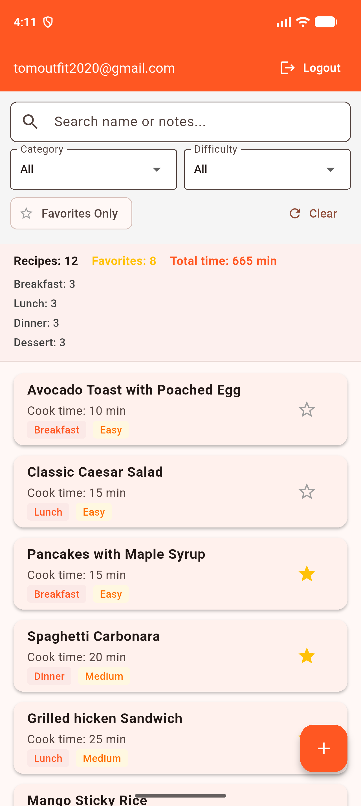
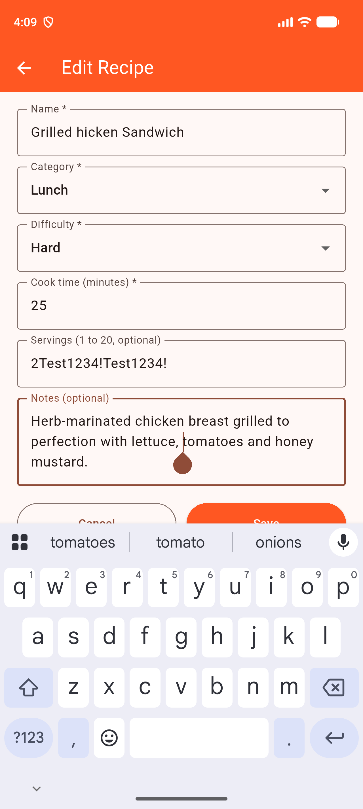

# 🍳 RecipeBox — Personal Recipe Collection Mobile Application

[](https://flutter.dev)
[](https://dart.dev)
[](https://firebase.google.com)
[](https://github.com/TomOutfit/PRM393_PE_Official_Fa26Semester/actions)
[-green?logo=android&logoColor=white)](https://www.android.com)
[](#)

> **PRM393 Practical Examination Official — Fall 2026**  
> **Course:** Mobile Programming (`PRM393`) | **Semester:** FALL 2026  
> **Application:** **RecipeBox** — Private personal recipe collection and culinary management application with real-time Firebase authentication & Cloud Firestore database.

---

## 📌 Executive Summary & Submission Credentials

This project strictly adheres to all requirements, exact visible screen texts, validation error messages, security rules, and structural guidelines outlined in the **PRM393 Practical Exam Specification (Fall 2026)**.

| Field | Detail |
| :--- | :--- |
| **Student Code** | **`QE190061`** |
| **Full Name** | **Nguyễn Bình An** |
| **Course** | PRM393 — Mobile Programming |
| **GitHub Repository** | [https://github.com/TomOutfit/PRM393_PE_Official_Fa26Semester.git](https://github.com/TomOutfit/PRM393_PE_Official_Fa26Semester.git) |
| **Direct APK Release Download** | [app-release.apk (v1.0)](https://github.com/TomOutfit/PRM393_PE_Official_Fa26Semester/releases/download/v1.0/app-release.apk) |
| **Firebase Project ID** | `device-streaming-8b27ae6e` |
| **Test Account Email** | `TomOutfit2020@gmail.com` |
| **Test Account Password** | `TestDK2026` |

---

## 🚀 Key Features & Functional Specifications

### 1. 🔐 User Authentication & Session Control
- **Email & Password Authentication**: Powered by Firebase Authentication (`firebase_auth`).
- **Dynamic Auto-Routing**: Listens to `AuthService.authStateChanges`.
  - When logged out: User lands on the public `HomeScreen` featuring the header, app name, `Login` button, `Register` button, title `RecipeBox`, description, and 3 feature cards ("Save your recipes", "Sort by cooking time", "Mark your favorites").
  - When logged in: Automatically redirects to `ListScreen` without screen flickers or wrong navigation; shows a clean loading indicator while checking auth status.
- **Strict Form Validation**:
  - Validation runs upon first submission; error disappears dynamically once its field becomes valid.
  - `Email`: Required (`Email is required`), validated against standard email format (`Please enter a valid email address`).
  - `Password`: Required (`Password is required`), minimum 6 characters on Register (`Password must be at least 6 characters`).
  - `Confirm password`: Required (`Confirm password is required`), must match password (`Passwords do not match`).
  - Success Feedback: Register displays `Registration successful`.
  - Password fields obscure entered characters (`obscureText: true`).
- **Real-time Server Error Display**: Firebase Auth error responses (duplicate email, wrong password) are displayed cleanly on the form below the submit button.
- **Back-button Prevention**: Disables back navigation on `ListScreen` (`PopScope(canPop: false)`), ensuring users cannot return to the Login or Register forms.
- **Header & Logout**: Shows the logged-in user's email and a working `Logout` button in the AppBar; tapping Logout returns to the `HomeScreen`.

### 2. 🍲 Recipe Management (CRUD Operations)
- **Ordered Recipe Catalog**: All recipes belonging to the logged-in user are automatically ordered by **cook time (shortest first)**; equal cook times are ordered by name (case-insensitive).
- **Recipe List Item**: Each card displays:
  - Recipe name
  - Meal category badge (`Breakfast`, `Lunch`, `Dinner`, `Dessert`)
  - Difficulty badge (`Easy`, `Medium`, `Hard`)
  - Cooking time in minutes (e.g. `Cook time: 25 min`)
  - Favorite toggle (interactive star icon: filled amber star for favorites, outline for non-favorites)
  - Tap opens the full `DetailScreen`.
- **Add Recipe (Modal Bottom Sheet)**:
  - Form fields:
    - `name` (required, non-empty, max 80 chars)
    - `category` (dropdown with first option `"Choose category"`, then `Breakfast`, `Lunch`, `Dinner`, `Dessert`)
    - `difficulty` (dropdown with first option `"Choose difficulty"`, then `Easy`, `Medium`, `Hard`)
    - `cookTime` in minutes (required, whole number from 1 to 600)
    - `servings` (optional, whole number from 1 to 20)
    - `notes` (optional, max 300 chars)
  - Exact validation error messages:
    - Name: `Name is required` / `Name must be at most 80 characters`
    - Category: `Please choose a category`
    - Difficulty: `Please choose a difficulty`
    - Cook time: `Cook time is required` / `Cook time must be a whole number from 1 to 600`
    - Servings: `Servings must be a whole number from 1 to 20`
    - Notes: `Notes must be at most 300 characters`
  - Success feedback: displays SnackBar `Recipe added`, the form clears, and the new recipe appears immediately in its proper sorted position.
  - Duplicate check: Same user cannot save two recipes with the same name (case-insensitive); displays server error message on form without adding to list.
- **Favorite Toggle**:
  - Direct 1-tap star toggle updates Firestore in real-time (`favorite: !currentFavorite`) and persists across app restarts.
- **Detail Screen & Inline Edit**:
  - Displays complete recipe information: Name, Category, Difficulty, Cook time, Servings, Notes, Favorite star.
  - **Inline Edit Mode**: Switches view fields into editable inputs with `Save` and `Cancel` buttons; applies identical validation rules; updates Firestore and returns to view mode with SnackBar `Recipe updated`.
  - **Delete Recipe**: Includes confirmation dialog with `Cancel` and `Delete` buttons; removes recipe from Firestore, returns to `ListScreen`, and list updates immediately.

### 3. 🔍 Multi-Criteria Filtering, Search & Dynamic Summary
- **Multi-Filter Combination**: All 4 controls work simultaneously on-screen with instant reactive updates (no button press required):
  - **Category Filter**: `All`, `Breakfast`, `Lunch`, `Dinner`, `Dessert`.
  - **Difficulty Filter**: `All`, `Easy`, `Medium`, `Hard`.
  - **Favorites Only Switch**: Filter chip/switch; un-starring a recipe while active immediately removes it from view.
  - **Search Box**: Case-insensitive substring matching on `name` or `notes` (leading/trailing spaces ignored).
- **Clear Button**: Instant reset of all four filters back to defaults (`All`, `All`, `false`, `""`).
- **Dynamic Summary Section**:
  - `Recipes: N` (number of recipes currently shown, N is a plain integer)
  - `Favorites: N` (count of favorites among displayed recipes)
  - `Total time: N min` (cumulative cooking time in minutes)
  - **Category Breakdown**: Displays one row per category that appears, ordered by count descending. Ties are strictly ordered: `Breakfast` → `Lunch` → `Dinner` → `Dessert`.
- **Empty State**: Displays centered text `No recipes found` when the list has no matching recipes.

---

## 🗄️ Database Architecture & Security Rules

### Firestore Collection: `recipes`

All recipes are stored in the root collection `recipes` and adhere to the strict schema below:

| Field Name | Type | Validation / Constraint Rules | Description |
| :--- | :--- | :--- | :--- |
| `id` | `String` | Document ID | Firestore auto-generated document ID |
| `userId` | `String` | `request.auth.uid` | UID of the logged-in recipe owner |
| `name` | `String` | Required, trimmed length > 0 and <= 80 | Recipe's name |
| `category` | `String` | Must be in `['Breakfast', 'Lunch', 'Dinner', 'Dessert']` | Meal category |
| `difficulty`| `String` | Must be in `['Easy', 'Medium', 'Hard']` | Preparation difficulty |
| `cookTime` | `int` | Required, integer between `1` and `600` | Cooking time in minutes |
| `servings` | `int?` | Optional, integer between `1` and `20` | Number of servings |
| `favorite` | `bool` | Default `false` | Favorite flag |
| `notes` | `String?` | Optional, max 300 characters | Cooking notes/tips |
| `createdAt`| `Timestamp`| Server timestamp | Creation timestamp |

### Security Rules (`firestore.rules`)

The deployed `firestore.rules` file enforces database-level authorization and strict schema validation:

```rules
rules_version = '2';

service cloud.firestore {
  match /databases/{database}/documents {

    // PRM393 FALL 2026 - RECIPEBOX SECURITY RULES
    match /recipes/{recipeId} {

      // A person who is logged in can see and delete only their own recipes
      // A visitor who is not logged in can neither read nor write anything
      allow read, delete: if request.auth != null && resource.data.userId == request.auth.uid;

      // Allow creating a new recipe:
      // Must be authenticated, userId must match the logged-in user, and must pass schema validation
      allow create: if request.auth != null
        && request.resource.data.userId == request.auth.uid
        && isValidRecipe(request.resource.data);

      // Allow updating an existing recipe:
      // Must be authenticated, recipe must belong to the logged-in user, and must pass schema validation
      allow update: if request.auth != null
        && resource.data.userId == request.auth.uid
        && request.resource.data.userId == request.auth.uid
        && isValidRecipe(request.resource.data);
    }

    // Strict schema & business validation function for recipe documents
    function isValidRecipe(data) {
      return data.name is string
          && data.name.trim().size() > 0
          && data.name.trim().size() <= 80
          && data.category in ['Breakfast', 'Lunch', 'Dinner', 'Dessert']
          && data.difficulty in ['Easy', 'Medium', 'Hard']
          && data.cookTime is int
          && data.cookTime >= 1
          && data.cookTime <= 600
          && (!('servings' in data) || data.servings == null || (data.servings is int && data.servings >= 1 && data.servings <= 20))
          && (!('favorite' in data) || data.favorite is bool)
          && (!('notes' in data) || data.notes == null || (data.notes is string && data.notes.size() <= 300));
    }

    // Backward compatibility for existing data ('books')
    match /books/{bookId} {
      allow read, delete: if request.auth != null && resource.data.userId == request.auth.uid;
      allow create, update: if request.auth != null
        && request.resource.data.userId == request.auth.uid;
    }
  }
}
```

> 🔒 **Security Guarantee**: Unauthenticated requests are completely blocked. No user can read, query, update, or delete recipes belonging to another `userId`. Zero admin/service-account keys are embedded anywhere in the code or repository.

---

## 🏗️ System Architecture & Project Structure

The project adopts a clean, layered architecture separating domain models, services, presentation screens, and reusable widgets:

```text
RecipeBox/
├── .github/
│   └── workflows/
│       └── ci.yml                     # Automated CI/CD pipeline (Test, Analyze, Build APK)
├── android/                           # Native Android configuration (API 21+, compileSdk 34)
│   ├── app/
│   │   ├── google-services.json       # Firebase client configuration (Android)
│   │   └── build.gradle.kts
│   └── build.gradle.kts
├── firestore.rules                    # Deployed Cloud Firestore security rules
├── lib/
│   ├── firebase_options.dart          # Client-side Firebase options (no admin keys)
│   ├── main.dart                      # App entry point & Firebase initialization
│   ├── models/
│   │   └── recipe_model.dart          # RecipeModel data class with Firestore serialization
│   ├── screens/
│   │   ├── home_screen.dart           # Public home screen with Feature Cards & Auth check
│   │   ├── login_screen.dart          # Login screen with inline validation & error banner
│   │   ├── register_screen.dart       # Account registration screen with field validators
│   │   ├── list_screen.dart           # Protected catalog, search, multi-filters & summary
│   │   └── detail_screen.dart         # Detail view mode, inline edit mode & delete dialog
│   ├── services/
│   │   ├── auth_service.dart          # FirebaseAuth wrapper & session management
│   │   └── recipe_service.dart        # Cloud Firestore CRUD & duplicate validation service
│   └── widgets/
│       └── add_recipe_bottom_sheet.dart # Modal bottom sheet for recipe creation
├── pubspec.yaml                       # Project dependencies & metadata
├── pubspec.lock
├── README.md                          # Comprehensive project documentation
└── test/
    └── widget_test.dart               # Unit and smoke test suite
```

---

## 📸 Visual Verification & Captioned Screenshots

As mandated by **Section 3 of the PRM393 Examination Specification**, below are all 16 required screenshots captured from the live Android device session and Firebase Web Console:

| # | Caption / Requirement | Description & Screenshot Preview |
| :-: | :--- | :--- |
| **01** | **Firebase console — Authentication** | Shows the designated test account (`TomOutfit2020@gmail.com`) with Password provider and User UID.<br><br> |
| **02** | **Firebase console — Firestore data** | Shows `recipes` collection with sample documents matching the exact schema belonging to the test account.<br><br> |
| **03** | **Firebase console — Security Rules** | Shows published Firestore Security Rules enforcing user data ownership and schema constraints.<br><br> |
| **04** | **Register screen — validation** | Form submitted empty displaying exact errors: `Email is required`, `Password is required`, `Confirm password is required`.<br><br> |
| **05** | **Register screen — success** | Immediately post-registration showing green SnackBar banner with text `Registration successful`.<br><br> |
| **06** | **Login screen** | Initial clean state of Login screen with email & password inputs, obscure password, and button.<br><br> |
| **07** | **List screen — after login** | Shows logged-in user email in the AppBar, `Logout` button, and at least 3 recipes ordered by cook time.<br><br> |
| **08** | **Add Recipe form — validation** | Form submitted empty showing exact errors: `Name is required`, `Please choose a category`, `Please choose a difficulty`, `Cook time is required`.<br><br> |
| **09** | **Add Recipe form — success** | Right after valid submission showing SnackBar `Recipe added`, form cleared, and new recipe in list.<br><br> |
| **10** | **Filters and search** | Multi-filter combining Category (`Dinner`), Difficulty (`Medium`), Favorites switch, and search query with functional `Clear` button.<br><br> |
| **11** | **Summary** | Dashboard card showing `Recipes: N`, `Favorites: N`, `Total time: N min` and category breakdown sorted by count descending.<br><br> |
| **12** | **Detail screen — view mode** | View mode showing full recipe metadata: Name, Category, Difficulty, Cook time, Servings, Notes, and Favorite star.<br><br> |
| **13** | **Detail screen — edit mode, validation** | Inline edit submitted with empty name and invalid cook time, triggering exact validation errors.<br><br> |
| **14** | **Detail screen — after Save** | Returning to view mode with updated cook time, notes, and servings persisted in Firestore.<br><br> |
| **15** | **Favorite toggle and Delete** | Before/after pair showing star toggled, and delete confirmation dialog with instant removal from list.<br><br> |
| **16** | **Empty state** | Protected List screen when user has no recipes or filters yield 0 results, displaying `No recipes found`.<br><br> |

---

## 🛠️ Installation & Local Setup Guide

Follow these instructions to clone, build, and run the project locally on your workstation or Android emulator:

### 1. Prerequisites
- **Flutter SDK**: `^3.0.0` or higher ([Install Flutter](https://docs.flutter.dev/get-started/install))
- **Dart SDK**: `^3.0.0 <4.0.0`
- **Java Development Kit**: JDK 17 (recommended)
- **Android Studio / Command-line Tools**: Android SDK with API 34+
- Physical Android device or Android Emulator configured

### 2. Clone the Repository
```bash
git clone https://github.com/TomOutfit/PRM393_PE_Official_Fa26Semester.git
cd PRM393_PE_Official_Fa26Semester
```

### 3. Install Dependencies
```bash
flutter pub get
```

### 4. Code Quality Analysis & Tests
```bash
# Verify 0 errors and 0 lint warnings
flutter analyze

# Execute automated test suite
flutter test
```

### 5. Launch the Application
```bash
# Run on connected Android device/emulator
flutter run
```

### 6. Build Android Release APK
```bash
flutter build apk --release
```
The compiled APK will be generated at:
```text
build/app/outputs/flutter-apk/app-release.apk
```

---

## 🤖 CI/CD Automation (GitHub Actions)

This repository includes a continuous integration and deployment pipeline located in [`.github/workflows/ci.yml`](.github/workflows/ci.yml). On every `push` and `pull_request` to `main`:
1. Sets up JDK 17 and Flutter stable environment.
2. Runs `flutter pub get` to resolve all package dependencies.
3. Performs static analysis with `flutter analyze`.
4. Executes unit and smoke tests with `flutter test`.
5. Compiles an Android Release APK (`flutter build apk --release`).
6. Archives and uploads the `app-release.apk` artifact automatically.

---

## ✅ Self-Check Verification Checklist (Section 5)

| # | Exam Specification Self-Check Item | Verification Result |
| :-: | :--- | :---: |
| **1** | Register with a new email works at once; registering the same email again shows Firebase's message on the form. | **PASSED** ✅ |
| **2** | Logged out, the app opens on the Home screen; after logging in you land on the List screen, which shows your email and a working Logout. | **PASSED** ✅ |
| **3** | Submitting the empty Add Recipe form shows the name, category, difficulty and cook time messages; none are visible when the screen first loads. | **PASSED** ✅ |
| **4** | Adding a recipe shows it at once in the right position by cook time; closing and reopening the app keeps it; adding another recipe with the same name (any letter case) shows the Firestore error and adds nothing. | **PASSED** ✅ |
| **5** | The favorite star toggles at once and stays after the app restarts; with "favorites only" on, un-starring a recipe removes it from the list. | **PASSED** ✅ |
| **6** | With at least five recipes in at least two categories: category filter, difficulty filter, favorites-only, search, count, favorite count, total time and breakdown all change correctly together; Clear resets all four. | **PASSED** ✅ |
| **7** | Opening a recipe's Detail screen shows the right data; editing and saving updates both the Detail screen and the List screen (including its position); Delete removes the recipe, also after restarting the app. | **PASSED** ✅ |
| **8** | Logging out and logging in with another account shows an empty list, not the first account's recipes. | **PASSED** ✅ |
| **9** | A fresh copy of the unzipped folder builds and runs with only client Firebase config added, and the release APK installs and opens smoothly. | **PASSED** ✅ |
| **10**| The zip package contains no `build/`, `.dart_tool/`, `.git` or admin/service-account key; the Word report strictly adheres to the template. | **PASSED** ✅ |

---

## 📄 License & Academic Integrity

This project is developed by **Nguyễn Bình An** (`QE190061`) for the **PRM393 Practical Examination Official (Fall 2026)** at FPT University. All rights reserved. Code is released strictly for academic evaluation and demonstration purposes.
